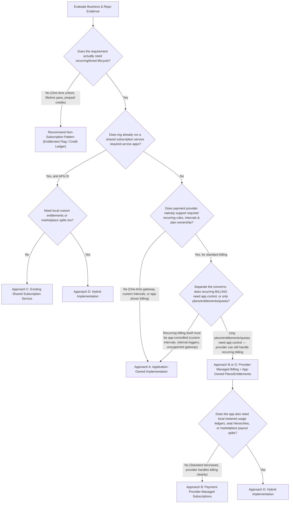

# Subscription Architecture Patterns & Decision Matrix

Use this reference during **Step 3 (Architecture Evaluation & Selection)** and **Step 4 (Architecture Proposal)**.

The most important responsibility of **Subscription Architect** is to recommend the right level of architecture for the target application based on concrete repository and business evidence—never forcing a single pattern onto every project.

---

## 0. Five Independent Subscription Concerns

Subscription systems involve several concerns that can be satisfied by **different layers independently**. Conflating them leads to overengineering. Evaluate each axis separately before choosing an approach.

| Concern | Who Can Own It | Notes |
| :--- | :--- | :--- |
| **1. Recurring Payment Scheduling & Collection** | Payment provider (Approach B/D) OR application cron/worker (Approach A/D) | This is what Approaches A, B, C, D describe. The choice here does **not** mandate who owns the other concerns. |
| **2. Plan & Price Management** | Application database (always possible) OR payment provider catalog | A marketplace can store seller-defined plans locally even when using Approach B for recurring billing. |
| **3. Subscription Ownership & State** | Application database (always) | The application always owns the canonical subscription record and lifecycle transitions, even in Approach B/C. |
| **4. Application-Specific Entitlements** | Application (always) | Feature access decisions, seat assignments, and resource limits are always application-owned, regardless of approach. |
| **5. Usage Quotas, Metering & Marketplace Commission** | Application (always) | These are application-side concerns in every approach. A provider's usage-based billing can supplement but not replace application-level quota enforcement. |

> **Key principle**: The Approach labels (A/B/C/D) describe **who schedules and executes recurring payment collection**. They do **not** mandate who owns plans, entitlements, or usage quotas. A marketplace may use Approach B (Stripe Connect) for recurring billing while keeping application-owned plan definitions, local entitlements, and usage quotas. Dynamic seller plans do **not** automatically require Approach A for billing.

---

## 1. The Four Core Architectural Approaches (Plus Non-Subscription)

---

## 2. Deep Dive: Each Architectural Approach

### Approach A: Application-Owned Implementation
In this model, the application's own backend and database act as the primary system of record for plans, subscription state transitions, billing cycle dates (`current_period_start`, `current_period_end`), and renewal scheduling. The payment gateway is used primarily as a payment rail (charging saved payment tokens or generating checkout sessions per cycle).

- **How It Works**:
  - Plans and pricing live in the application database (or config).
  - The application calculates renewal dates, trial expirations, grace periods, and proration amounts.
  - For recurring charges, either:
    1. A scheduled background worker charges a tokenized payment method via the gateway API on the renewal date, or
    2. For gateways without off-session tokenization, the application generates a renewal invoice/payment link, transitions the subscription to `past_due` / `pending_renewal` if unpaid by `current_period_end`, and extends the period upon verified payment webhook.
- **When to Choose Approach A**:
  - The chosen payment gateway does **not** support native recurring subscriptions or lacks flexible plan APIs (common with regional payment gateways).
  - Billing rules depend heavily on internal domain events (e.g., pauses tied to project inactivity, custom academic/seasonal calendars) that cannot be modeled in the provider's subscription engine.
  - The application already has an established application-owned subscription table and merely needs extension or hardening.
  - **Note**: Marketplaces with dynamic seller plans do NOT automatically require Approach A. If the payment provider supports Connect or split charges, Approach D (provider billing + app-owned plans) is often better. Evaluate the billing scheduling concern separately from the plan management concern.
- **Trade-offs & Risks**:
  - **Pros**: Complete control over domain modeling, zero catalog sync drift with external providers, works with any payment gateway.
  - **Cons**: The application must reliably run scheduled jobs (cron/workers) for trial expirations, renewal triggers, and grace period cutoffs; higher responsibility for idempotent charging and dunning emails.

---

### Approach B: Payment-Provider-Managed Subscriptions
In this model, the payment provider's native subscription engine (e.g., Stripe Billing, Paddle, Chargebee, Razorpay Subscriptions, PayPal Subscriptions) manages the recurring billing schedule, automatic card retries (dunning), proration math, and invoice generation. The application stores a synchronized local representation of the subscription state and enforces local feature authorization.

- **How It Works**:
  - Plans/Prices are configured in the payment provider (and optionally mirrored in local config or a lightweight `plans` table).
  - Checkout or subscription creation happens via the provider's API/hosted checkout, passing the application's `user_id` or `organization_id` in metadata/client reference fields.
  - Provider webhooks (`subscription.created`, `subscription.updated`, `subscription.deleted`, `invoice.paid`, `invoice.payment_failed`) update the local `subscriptions` table.
  - The application's authorization middleware checks the local `subscriptions` table (never querying the payment provider API synchronously on every user request).
- **When to Choose Approach B**:
  - Small-to-medium SaaS applications with standard monthly/annual tiers or per-seat billing.
  - The payment provider natively supports all required billing intervals, trials, and retry rules.
  - The team wants to minimize custom billing engine maintenance, tax calculation, and PCI/payment compliance overhead.
- **Trade-offs & Risks**:
  - **Pros**: Offloads recurring charge scheduling, card retry scheduling, proration calculations, and invoice PDFs to battle-tested provider infrastructure.
  - **Cons**: Requires rock-solid webhook handling (idempotency, out-of-order events, reconciliation fallback) to prevent state drift between the provider and local database; harder to customize if business rules diverge from the provider's data model.

---

### Approach C: Existing Shared Subscription Service
In this model, the organization already operates an internal centralized subscription microservice (or an external enterprise entitlement platform) across multiple products, and this application integrates as a client of that service.

- **How It Works**:
  - The shared service owns payment provider communication, subscription lifecycle, and invoice management.
  - The application authenticates with the shared service via service-to-service APIs, webhooks/event bus, or signed JWT entitlement claims.
  - **Local Projection & Outage Resilience Pattern**: Never make a synchronous blocking HTTP call to the shared billing service on every user request without a local fallback. Maintain a local `organization_entitlements` projection table (or short-TTL cache) updated via signed events from the shared service and refreshed lazily when a user's JWT `entitlements_version` claim advances, so a brief 30-second network blip in the central billing service never takes down core application reads.
  - Before recommending Approach C, you **must** inspect or verify the shared service's API contract, availability/latency guarantees, tenant isolation, failure fallback, and ownership boundaries.
- **When to Choose Approach C**:
  - The repository is one service within a multi-app ecosystem where customers buy cross-product bundles or unified organization plans managed by an existing billing service.
  - Existing code in the repository (or explicit developer context) shows an active integration with a shared billing service.
- **When to Reject Approach C**:
  - **Never** invent or propose building a brand-new standalone subscription microservice for a single application. Building a separate microservice when none exists adds network latency, distributed transaction failures, deployment overhead, and auth duplication without solving a real problem.
- **Trade-offs & Risks**:
  - **Pros**: Unified customer billing across multiple applications; avoids duplicating payment gateway integrations across microservices.
  - **Cons**: Network dependency on the shared service (requires local caching or signed claims so a billing service outage does not take down core app reads); coordination overhead when adding app-specific entitlements.

---

### Approach D: Hybrid Implementation
In this model, responsibilities are intentionally split across layers because no single approach cleanly satisfies both financial billing and complex domain entitlements.

- **Common Hybrid Patterns**:
  1. **Provider-Managed Billing + Application-Owned Entitlement & Usage Ledger**: The payment provider manages the recurring base subscription and invoicing, while the application owns a granular feature entitlement engine, seat assignment hierarchy, or real-time usage/credit burn ledger that reports aggregated overages back to the provider at period end.
  2. **Provider-Managed Billing (Stripe Connect) + Application-Owned Marketplace Plans**: Sellers define plans and subscriber relationships entirely in the application database. The payment provider (via Connect destination charges or `application_fee_amount`) handles recurring billing execution and payout splits. The application does **not** sync seller plans to the provider's product catalog — it stores them locally and passes price amounts to the Connect charge API.
  3. **Application-Owned Marketplace Plans + Provider Recurring Mandate / Tokenization**: Sellers define plans in the application database, while the payment provider stores recurring payment mandates/tokens and executes merchant-initiated charges + split payouts when triggered by the application.
  4. **Shared Billing Service + Local App Entitlement Cache**: A shared enterprise billing service manages contracts and payments, publishing lifecycle events to the application, which maintains its own local domain-specific entitlement projection and resource quotas.
- **When to Choose Approach D**:
  - Complex B2B multi-tenant apps with custom seat/role hierarchies, add-on bundles, and metered usage quotas.
  - Marketplaces where seller-defined plans and platform fee splits cannot be modeled cleanly in the provider's native catalog alone — but the provider (e.g., Stripe Connect) can still handle recurring billing execution and payouts.
- **Trade-offs & Risks**:
  - **Pros**: Combines the financial reliability of provider billing with complete domain flexibility for entitlements.
  - **Cons**: Requires clear boundary definitions (who is the source of truth for billing dates vs. feature limits?) to avoid split-brain bugs.

---

## 3. Comparative Evaluation Checklist

When writing Section 4 ("Why It Was Selected") and Section 5 ("Alternatives Considered") of the Architecture Proposal, compare the four approaches across these six criteria:

| Criterion | Questions to Answer |
| :--- | :--- |
| **1. Gateway Compatibility** | Does the application's payment gateway actually support native recurring subscriptions, webhooks, and the required currencies/regions? (Verify per §1.1 of `payment-integration.md` — do not assume.) |
| **2. Domain Fit** | Who creates plans (fixed platform vs. dynamic sellers)? Who owns subscriptions (User vs. Organization vs. multi-seller)? Remember: dynamic seller plans do not automatically mandate Approach A for recurring billing. Evaluate plan management and billing scheduling as separate concerns. |
| **3. Operational Complexity** | Does this introduce unnecessary background workers, extra services, or external sync state that a smaller team doesn't need? |
| **4. Existing Codebase Alignment** | Does the repository already have tables, SDKs, or shared service clients that favor one approach and minimize migration risk? |
| **5. Reliability & Failure Blast Radius** | What happens when a webhook is delayed, a cron job fails, or an external service is temporarily unreachable? |
| **6. Security & Auditability** | How easily can payment authenticity, idempotency, and tenant access isolation be enforced and tested? |

---

## 4. Anti-Overengineering Rules

Apply these guardrails strictly when formulating recommendations:

1. **No Unjustified Microservices**: If the project is a monolith or standard backend + frontend app, keep subscription logic inside the existing backend module structure. Do not recommend spinning up a separate billing microservice.
2. **No Premature Multi-Gateway Abstraction Layers**: Unless the developer explicitly requires active multi-gateway routing (e.g., Stripe for USD/EUR + PayHere for LKR simultaneously), do not build an over-abstracted "Universal Payment Provider Factory Interface" with 15 adapter methods. Keep provider integration clean and modular (e.g., a focused `PaymentService` or `BillingGateway` module) without speculative abstractions.
3. **Hard-Coded Config vs. Database Plan Builder**: If a small app has 2 fixed plans (`Free` and `Pro` at `$10/mo`) and no requirement for non-technical admins to create plans dynamically at runtime, defining plan metadata in version-controlled code/constants (paired with a `plan_id` on the `subscriptions` table) is often simpler, safer, and easier to test than building a full CRUD admin plan-builder UI. Use a `plans` database table when plans are dynamic, relational integrity is desired, or multiple entities create plans.
4. **Preserve Working Code**: If the repository already has a working payment integration or partial subscription table, extend and harden it incrementally rather than proposing a ground-up rewrite, unless the existing design has critical security flaws that cannot be patched in place.
5. **Dynamic Plans ≠ Application-Owned Billing**: If a marketplace has thousands of seller-defined plans but the payment provider supports Connect or split charges for recurring billing, Approach D (local plans + provider recurring billing) may be simpler and more reliable than building an application-owned billing scheduler (Approach A). Do not conflate plan management complexity with billing scheduling complexity.
