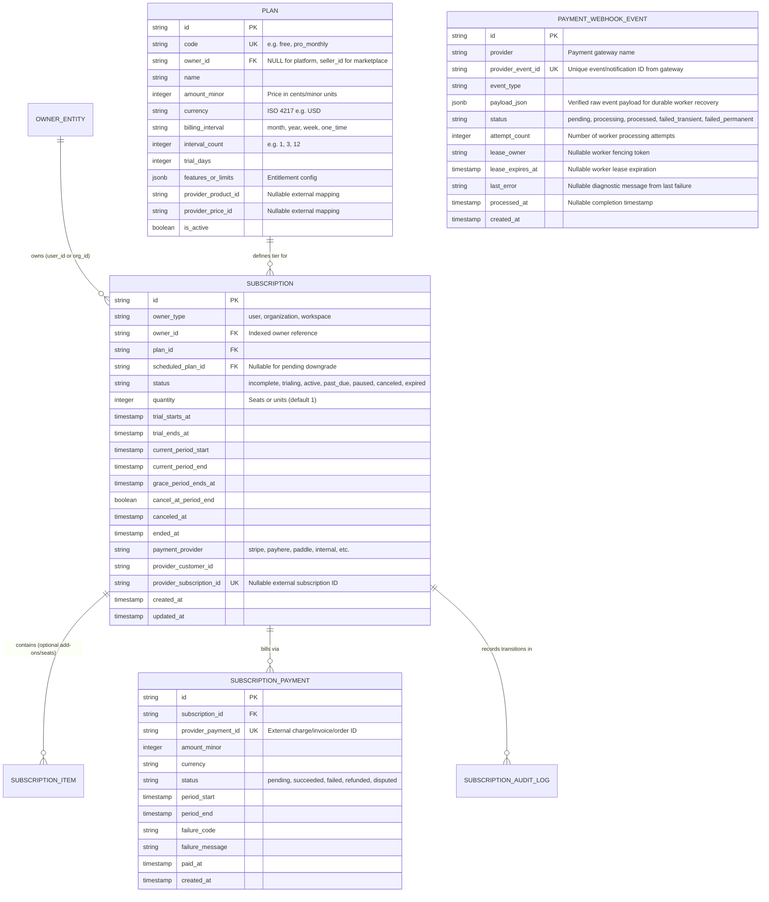

# Subscription Database Design & Schema Patterns

Use this reference during **Step 4 (Architecture Proposal)** and **Step 6 (Implementation Mode)** to design right-sized, relational or document database schemas that match the application's complexity.

---

## 1. Right-Size the Schema to the Application

Do **not** create 12 billing tables for an application that only needs two fixed plans. Select the schema tier that matches the application's actual requirements:

| Schema Tier | Target Application Type | Tables / Collections Needed |
| :--- | :--- | :--- |
| **Tier 1: Minimal** | Small B2C/B2B app with static plans (defined in code/config) and provider-managed billing (**Approach B**). | 1. `subscriptions` (or columns on `users`/`organizations` if strictly 1:1 without history, though a separate `subscriptions` table is preferred)<br/>2. `payment_webhook_events` (idempotency log) |
| **Tier 2: Standard** | App with dynamic/admin-configurable plans, trials, scheduled downgrades, or application-owned billing (**Approach A / B**). | 1. `plans` (and `plan_prices` if multi-currency/multi-interval)<br/>2. `subscriptions`<br/>3. `subscription_payments` / `invoices`<br/>4. `payment_webhook_events` |
| **Tier 3: Multi-Tenant / Marketplace / Hybrid** | Marketplace with seller-owned plans, per-seat/add-on items, usage metering, or audit compliance (**Approach A / D**). | 1. `plans` (with `owner_id` / `seller_id`)<br/>2. `subscriptions`<br/>3. `subscription_items` (base plan + add-ons + seats)<br/>4. `entitlement_grants` / `usage_records`<br/>5. `subscription_payments` & `seller_payouts`<br/>6. `payment_webhook_events` & `subscription_audit_logs` |

---

## 2. Core Entity Relationship Diagram (Standard & Hybrid)



---

## 3. Critical Schema Design Rules

### A. Store Money in Minor Units (Integers) or Exact Decimals
- **Never** use floating-point types (`FLOAT`, `REAL`, `DOUBLE`, JS `number` float math) for prices, totals, or prorations.
- Prefer integer minor units (`amount_minor: 1999` for `$19.99` USD) or fixed-precision `NUMERIC(12, 2)` / `DECIMAL` paired with an explicit ISO 4217 `currency` column (`'USD'`, `'EUR'`, `'LKR'`).
- Watch out for zero-decimal currencies (e.g., `JPY`, `KRW`) if supporting international currencies.

### B. Separate `subscriptions` from the `users` Table
- Even if a user can only have one active subscription today, avoid cramming 12 billing columns (`stripe_sub_id`, `plan_id`, `period_end`, `trial_end`, `cancel_at`, etc.) directly onto the `users` table unless the existing codebase already mandates that pattern.
- A dedicated `subscriptions` table:
  1. Preserves historical records when a user cancels and re-subscribes later.
  2. Makes it painless to migrate from user-owned (`user_id`) to organization-owned (`organization_id`) subscriptions later.
  3. Supports marketplace models where a single user subscribes to multiple creators/sellers simultaneously.

### C. Prevent Duplicate Active Subscriptions with Constraints
- A common race condition occurs when a user double-clicks "Checkout" or two webhooks arrive simultaneously, creating two active subscriptions for the same user/organization.
- Enforce uniqueness at the database level:
  - **PostgreSQL / SQLite Partial Unique Index**:
    ```sql
    CREATE UNIQUE INDEX idx_unique_active_sub_per_owner
    ON subscriptions (owner_type, owner_id)
    WHERE status IN ('trialing', 'active', 'past_due');
    ```
    *(For marketplaces where a buyer can subscribe to multiple sellers, scope the index to `(buyer_id, seller_id)` instead.)*
  - **MySQL / Databases Without Partial Indexes**:
    Use a unique constraint on `provider_subscription_id` plus application-level row locking (`SELECT ... FOR UPDATE` on the `user` or `organization` row) before inserting a new subscription.

### D. Preserve Plan Pricing Snapshots (Grandfathering)
- If an admin changes a plan's price in the `plans` table from `$10/mo` to `$15/mo`, what happens to existing subscribers?
- Either:
  1. Treat `plan_prices` as **immutable** (creating a new price row `pro_v2_15_usd` for new checkouts while existing subscriptions remain linked to `pro_v1_10_usd`), **OR**
  2. Snapshot `unit_amount_minor` and `currency` directly onto the `subscriptions` (or `subscription_items`) row at checkout time so historical and grandfathered billing amounts remain accurate.

### E. Index for Hot Authorization & Background Queries
Every subscription schema should include indexes for its two hottest query paths:
1. **Authorization / Entitlement Lookup (Hot Path on API requests)**:
   - Index on `(owner_type, owner_id, status)`.
2. **Webhook & Renewal Lookup**:
   - Unique index on `(payment_provider, provider_subscription_id)`.
   - Unique index on `payment_webhook_events (provider, provider_event_id)` for atomic event deduplication.
   - Index on `payment_webhook_events (status, lease_expires_at)` for the internal worker recovery sweep (`status IN ('pending', 'failed_transient') OR (status = 'processing' AND lease_expires_at <= now)`).
   - Index on `(status, current_period_end)` for background renewal, trial expiration, and reconciliation jobs.

> **Webhook Event Schema Sizing**:
> - For the **Selected Primary Model (Durable Asynchronous Processing with Leased Worker Fencing)**, include `provider`, `provider_event_id` (unique per provider), `event_type`, `payload_json`, `status` (`pending`, `processing`, `processed`, `failed_transient`, `failed_permanent`), `attempt_count`, `lease_owner` (fencing token), `lease_expires_at`, `last_error`, `processed_at`, and `created_at`.
> - For the **Lightweight Synchronous Single-Transaction Alternative (Option A)** where the event row and subscription state update commit or roll back together inside a single transaction, `lease_owner`, `lease_expires_at`, and `payload_json` are not required (`id`, `provider`, `provider_event_id`, `event_type`, `status`, `attempt_count`, `last_error`, `processed_at`, `created_at` suffice).

### F. Quota Reset Sub-Periods & Two-Phase Reservation Columns
When plans include metered usage quotas (e.g., 50 downloads/month on an annual plan) or long-running jobs that reserve credits:
- **Explicit Quota Reset Period**: Store `quota_reset_policy` (`'calendar_month'`, `'subscription_anniversary'`, or `'rolling_30d'`) or track `quota_period_start` and `quota_period_end` explicitly on the quota/ledger table. On annual plans with monthly subscription-anniversary resets, derive each sub-period from `current_period_start + N months` (never from `current_period_end`, which is 12 months away).
- **Reservation Lease & Recovery Columns**: For two-phase quota/credit reservations (`status IN ('reserved', 'consumed', 'released')`), include `reserved_until TIMESTAMP`, `idempotency_key VARCHAR UNIQUE`, and an index on `(status, reserved_until)` so abandoned reservations from crashed workers can be expired and refunded deterministically without allowing delayed workers to consume already-released reservations.

---

## 4. Safe Migration Strategy for Existing Production Data

When modifying an application that already has users or legacy billing data:
1. **Expand-Contract Pattern**:
   - **Phase 1 (Expand)**: Add new tables/columns as nullable or with safe defaults. Do not rename or drop existing columns read by running application instances.
   - **Phase 2 (Backfill & Dual-Write)**: Backfill existing user tiers/legacy payment records into the new `subscriptions` structure idempotently. Update webhook handlers and mutation paths to **dual-write** to both the new `subscriptions` table and legacy columns during the rollout window. Verify row counts and entitlement parity.
   - **Phase 3 (Switch Reads)**: Update authorization middleware to read from the new subscription model (with fallback if needed).
   - **Phase 4 (Contract)**: Remove dual-writes and drop deprecated columns only in a future cleanup release after explicit approval.
2. **Grandfathering Legacy Tiers & Restricting New Checkouts**:
   - When migrating legacy paying users (e.g., `users.is_pro_subscriber = true` at a legacy `$25/mo` price) into a new multi-tier catalog, map them to a dedicated grandfathered plan code (e.g., `pro_legacy`) with `is_selectable_for_new_checkout = false` so they keep their existing price and entitlements while new checkouts cannot select the legacy price.
3. **Hybrid User + Workspace / Organization Ownership Transitions**:
   - When an existing application with `user_id` subscriptions introduces `workspaces` or `organizations`, either map every solo user to a default personal workspace (`workspace_id`) during the Phase 2 backfill, or use an explicit `(owner_type, owner_id)` polymorphic reference with a database `CHECK` constraint so solo and team subscriptions cannot become ambiguous.
4. **Default Entitlement for Existing Users**:
   - Explicitly clarify with the developer whether existing registered users before the subscription launch should be mapped to a `free` tier, granted a complimentary transition trial, or grandfathered into a paid tier.
