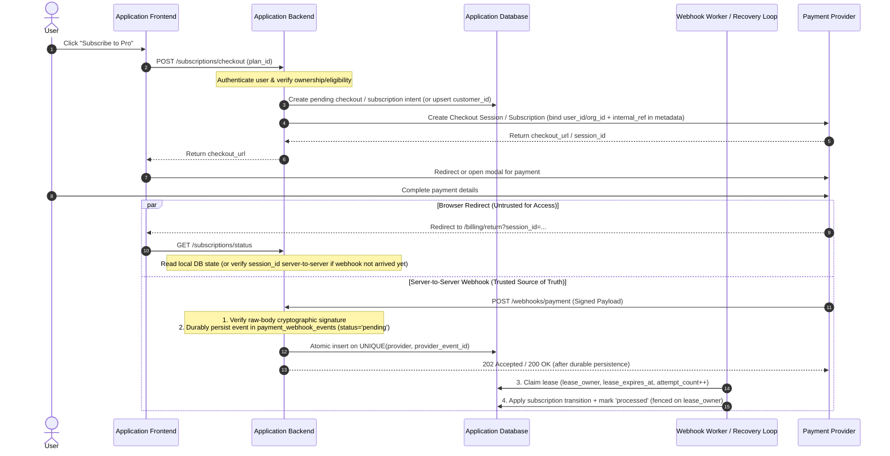

# Payment Integration & Webhook Reliability Guide

Use this reference during **Step 3 (Architecture Evaluation)**, **Step 4 (Architecture Proposal)**, and **Step 6 (Implementation Mode)** to design secure, idempotent payment and webhook flows.

---

## 1. Classify the Payment Provider Capabilities First

Never assume every payment gateway works like Stripe. Before designing the payment flow, classify the target payment provider across these four capabilities:

| Capability Dimension | Type 1: Full Native Subscription Engine | Type 2: Tokenized / Mandate Recurring (Merchant-Initiated) | Type 3: One-Time Checkout / Redirect Only |
| :--- | :--- | :--- | :--- |
| **Examples** | Stripe Billing, Paddle, Chargebee, Razorpay Subscriptions, PayPal Subscriptions, PayHere Recurring API | Stripe PaymentIntents (`setup_future_usage`), Adyen Recurring, Braintree Vault, local bank tokenization APIs | Standard one-time checkout gateways, bank transfer/QR gateways, regional redirect gateways without recurring APIs |
| **Who Schedules Renewals?** | Payment Provider | Application (via scheduled worker charging saved token/mandate) | Application (generates renewal invoice/checkout link; user must complete payment each cycle) |
| **Who Calculates Proration & Retries?** | Payment Provider | Application | Application |
| **Best Architectural Fit** | **Approach B** (Provider-Managed) or **Approach D** (Hybrid) | **Approach A** (Application-Owned) or **Approach D** (Hybrid) | **Approach A** (Application-Owned with manual/link renewal lifecycle) |

### 1.1 Provider Capability Verification Checklist

Before recommending any approach, verify the following capabilities against the provider's **official documentation for the specific API version in use**. Do not assume capabilities from generic SDK or REST API availability alone.

- [ ] **Native recurring subscription engine** — provider auto-schedules and executes charges on a fixed interval without application cron involvement.
- [ ] **Tokenization / saved payment methods** — provider can store a payment method and later accept merchant-initiated charges against it off-session.
- [ ] **Mandate / authorization framework** — provider supports pre-authorized debits (required for bank debit / ACH / SEPA / BACS schemes in many markets).
- [ ] **Automatic payment retries / dunning** — provider retries failed renewal charges on a configurable schedule without application-side orchestration.
- [ ] **Supported countries and settlement currencies** — verify that the target market's country and currency are covered. A gateway being internationally available does not guarantee coverage in every country.
- [ ] **Refund, dispute, and cancellation events** — verify the exact webhook event names for refunds, chargebacks, subscription cancellations, and payment failures (do not guess from generic naming conventions).
- [ ] **Webhook signature mechanism** — identify the exact signature header name, signing algorithm, timestamp field name, and recommended tolerance window. Distinguish between:
  - **Strong** (e.g., HMAC-SHA256 with timestamp tolerance): recommended for all production integrations.
  - **Weak / legacy** (e.g., plain MD5 without timestamp, IP allowlist only): flag as a security risk; recommend upgrading to HMAC-SHA256 if the provider supports it, and explicitly document the limitation if not.
- [ ] **Idempotency key support** — verify that the provider's charge, subscription-creation, and refund APIs accept an idempotency key to prevent duplicate operations on network retry.

> **Important Uncertainty Rule**: Never fabricate SDK methods, webhook event names, or signature headers for a payment provider. If the repository does not contain the SDK/docs and you are not 100% certain of the provider's exact webhook payload format or recurring API parameters, explicitly flag the exact fields to verify against the provider's official documentation.

---

## 2. End-to-End Checkout & Activation Flow

A secure subscription checkout flow **separates client navigation from server-side activation**:



### Critical Rules for Checkout & Activation
1. **Bind Internal Identity at Initiation**: When creating a checkout session or payment request, always attach the internal `user_id` / `organization_id`, `plan_id`, and an internal `checkout_reference_id` in the provider's signed metadata or `custom_fields` parameter. Do not rely on matching customer email addresses on webhook arrival (users often enter a different billing email at checkout).
2. **Never Activate on Frontend Redirect Alone**: A user visiting `/billing/success?sub=123` proves nothing—anyone can type that URL into a browser. Access is granted only when:
   - The server verifies a signed webhook from the provider, **OR**
   - The server makes a direct, authenticated server-to-server API call to the provider (`GET /sessions/:id` or `GET /payments/:id`), confirms `status == paid` and matching metadata, and runs the same idempotent activation function used by the webhook handler.
3. **Handle the Redirect-Before-Webhook Race Condition**: Users are often redirected back to the app 1–3 seconds *before* the asynchronous webhook arrives. Handle this gracefully by either:
   - Having the return endpoint perform a server-to-server status lookup by `session_id` and run the idempotent activation logic immediately, or
   - Showing a brief "Confirming your payment..." polling state on the frontend for a few seconds until the webhook updates the database.

---

## 3. Webhook Security, Idempotency & Crash-Recovery Architecture

Payment gateways use **at-least-once delivery** and may deliver duplicate events concurrently or out of order.

### 3.1 Choosing a Consistent Processing Model (Never Mix Both)

A common architectural bug is **mixing incompatible parts of synchronous and asynchronous processing**: for example, committing a `status = 'processing'` claim row outside the business transaction, returning `200 OK` when a concurrent duplicate arrives, and expecting a future provider retry to re-process a crashed event. That design fails because:
1. Once the provider receives `200 OK`, it stops retrying.
2. Resetting an existing row to `pending` does not allow a naive `INSERT ... ON CONFLICT DO NOTHING` to claim it again because the unique `(provider, provider_event_id)` row already exists.

Choose **one** consistent model below and follow its rules strictly:

| Dimension | **Selected Primary Model: Durable Asynchronous Processing (Transactional Inbox + Leased Worker Fencing)** | **Lightweight Alternative: Synchronous Single-Transaction Processing** |
| :--- | :--- | :--- |
| **How It Works** | 1. HTTP handler verifies signature and durably persists the raw event (`status = 'pending'`, `payload_json`) in `payment_webhook_events` (or transactional outbox/queue), then returns `202`/`200`.<br/>2. A worker claims the event with a fenced lease (`lease_owner`, `lease_expires_at`, `attempt_count + 1`).<br/>3. Inside one DB transaction, the worker applies the subscription state transition AND marks the event `processed` **only if `lease_owner` still matches**. | 1. HTTP handler verifies signature.<br/>2. Inside **one single DB transaction**, the handler inserts the event (`status = 'processed'`) AND applies the subscription state transition, then commits.<br/>3. If anything fails before commit, the entire transaction (including the event claim) rolls back automatically. |
| **Crash Recovery** | **Self-healing without provider retry**: If a worker crashes after durable enqueue or after claiming a lease, an internal recovery loop sweeps rows where `status = 'pending'` or `(status = 'processing' AND lease_expires_at <= now)`, reclaims them with a new `lease_owner`, and finishes processing from the stored `payload_json`. | **Provider-driven retry**: Because a crash or error rolls back the entire transaction (leaving no row in `payment_webhook_events`), the HTTP request fails (`5xx`/timeout) and the payment provider retries the webhook delivery cleanly. |
| **When to Choose** | **Default recommendation for production systems**, high-volume apps, apps that trigger downstream provisioning/emails, or whenever durable self-recovery without relying on provider retries is required. | Small, simple applications where webhook handling is purely a fast local SQL update (<50ms) with zero external I/O and no background worker process. |

> **Anti-Pattern Warning**: Never commit a `status = 'processing'` row in a separate transaction unless you also persist the event payload durably and run an internal lease-recovery worker (the Durable Asynchronous model). Conversely, in the Synchronous Single-Transaction model, never commit the event claim separately from the subscription state change and never return `200 OK` while an un-committed transaction is still in flight without waiting for its outcome.

---

### 3.2 Primary Pipeline: Durable Asynchronous Processing with Lease Fencing

#### Step 1: Verify Raw Body Signature & Timestamp
- Read the exact unparsed raw request body.
- Verify the cryptographic signature header (`HMAC-SHA256` / RSA) using `crypto.timingSafeEqual` or the official provider SDK and enforce the timestamp replay tolerance window (e.g., $\le 5$ minutes).
- Return `400 Bad Request` or `401 Unauthorized` immediately if verification fails.

#### Step 2: Durable Inbox Persistence (Atomic Acceptance)
- Insert the verified event into `payment_webhook_events` with a `UNIQUE (provider, provider_event_id)` constraint:
  - **PostgreSQL**:
    ```sql
    INSERT INTO payment_webhook_events
      (id, provider, provider_event_id, event_type, payload_json, status, attempt_count, created_at)
    VALUES ($1, $2, $3, $4, $5, 'pending', 0, NOW())
    ON CONFLICT (provider, provider_event_id) DO NOTHING;
    ```
  - **MySQL 8+**: `INSERT IGNORE INTO payment_webhook_events ...`
  - **SQLite**: `INSERT OR IGNORE INTO payment_webhook_events ...`
- **If 1 row was inserted**:
  - The event is now durably stored in the database. Trigger/notify the worker (in-process async dispatch or queue consumer) and return `202 Accepted` (or `200 OK`) to the provider.
- **If 0 rows were inserted** (the `(provider, provider_event_id)` row already exists):
  - Query the existing row's `status` and `lease_expires_at`:
    - `status = 'processed'`: Already processed duplicate $\rightarrow$ return `200 OK` immediately.
    - `status = 'pending'` or (`status = 'processing'` and `lease_expires_at > now`): Already durably accepted and either queued or actively being processed by another worker $\rightarrow$ return `202 Accepted` / `200 OK` (no duplicate work started; internal worker/recovery guarantees completion).
    - `status = 'failed_transient'` or (`status = 'processing'` and `lease_expires_at <= now`): Stale or transiently failed event $\rightarrow$ trigger internal worker reclamation and return `202 Accepted` / `200 OK`.
    - `status = 'failed_permanent'`: Unrecoverable business-data anomaly already recorded for manual investigation $\rightarrow$ return `200 OK` so the provider does not retry endlessly.
- **If the database itself is unreachable or throws a transient error during durable insert**:
  - Do **not** acknowledge the webhook. Return `500` or `503` so the payment provider retries delivery.

#### Step 3: Leased Worker Claiming (With Fencing Token)
- When a worker picks up a `pending`, `failed_transient`, or lease-expired `processing` event, it generates a unique fencing token `lease_owner` (e.g., `wrk_<uuid>`) and executes an atomic conditional `UPDATE`:
  ```sql
  UPDATE payment_webhook_events
  SET status = 'processing',
      lease_owner = :worker_token,
      lease_expires_at = :now_plus_lease_duration,
      attempt_count = attempt_count + 1
  WHERE provider = :provider
    AND provider_event_id = :event_id
    AND (
      status IN ('pending', 'failed_transient')
      OR (status = 'processing' AND lease_expires_at <= :now)
    );
  ```
- If the affected row count is `0`, another worker already holds a valid lease or completed the event; exit immediately without executing business logic.

#### Step 4: Fenced Atomic State Transition & Completion
- Perform any required external API reads *before* opening the database transaction so network latency never holds open database locks.
- Open a database transaction (`BEGIN` / `BEGIN IMMEDIATE` in SQLite, or `SELECT ... FOR UPDATE` on the target `subscriptions` row in PostgreSQL/MySQL):
  1. **Verify the lease fence**:
     ```sql
     UPDATE payment_webhook_events
     SET status = 'processed',
         processed_at = :now,
         lease_owner = NULL,
         lease_expires_at = NULL,
         last_error = NULL
     WHERE provider = :provider
       AND provider_event_id = :event_id
       AND status = 'processing'
       AND lease_owner = :worker_token
       AND lease_expires_at > :now;
     ```
     If `0` rows are updated, **this worker's lease expired and another worker may have reclaimed the event**. Immediately `ROLLBACK` / abort the transaction (`StaleLeaseError`) so the expired worker never overwrites a newer worker's state!
  2. **Apply subscription state transition with out-of-order protection**:
     - Compare the event's timestamp (`event_created`) against `subscription.last_event_created`. For example, if `customer.subscription.deleted` (timestamp $T_2$) has already been applied, a delayed `customer.subscription.updated` (timestamp $T_1 < T_2$) must not resurrect a canceled subscription.
  3. **Commit the transaction**: Both the `subscriptions` state transition and the `payment_webhook_events` transition to `status = 'processed'` commit atomically.

#### Step 5: Internal Crash & Failure Recovery (Without Provider Retries)
- **Worker Crash After Durable Enqueue or Lease Claim**:
  - If a worker crashes while `status = 'pending'` or while holding a lease (`status = 'processing'`), a periodic internal recovery sweep (`recoverStaleWebhookEvents`) queries all rows where `status IN ('pending', 'failed_transient') OR (status = 'processing' AND lease_expires_at <= :now)` and processes them from `payload_json`. Because recovery uses the durably stored payload, it succeeds **without requiring another webhook delivery from the payment provider**.
- **Transient Infrastructure Error During Worker Processing**:
  - If a database deadlock or transient error occurs during Step 4, the transaction rolls back and the worker updates the event row (guarded by `WHERE lease_owner = :worker_token`) to `status = 'failed_transient'`, `last_error = :error_message`, `lease_owner = NULL`, `lease_expires_at = NULL` so the internal recovery worker retries with backoff.
- **Business-Data Anomaly (Permanent Error)**:
  - If the payload fails business validation (e.g., currency/amount mismatch against the server's authoritative plan price, or corrupt un-routable metadata), record `status = 'failed_permanent'`, `last_error = :error_message`, `lease_owner = NULL`, `lease_expires_at = NULL`, and alert engineering.

---

### 3.3 Alternative Pipeline: Synchronous Single-Transaction Processing (Option A)

When an application has no background worker infrastructure and processes webhooks synchronously in the HTTP request:
1. Verify raw-body cryptographic signature (`400`/`401` on failure).
2. Perform any external network calls *before* opening the database transaction.
3. Open **one single database transaction**:
   - Insert into `payment_webhook_events (id, provider, provider_event_id, event_type, status, processed_at, created_at) VALUES (..., 'processed', :now, :now)`.
   - On unique conflict (`(provider, provider_event_id)` already committed by an earlier transaction), `ROLLBACK` (or `DO NOTHING`) and return `200 OK` (already processed duplicate).
   - Otherwise, lock the target subscription row, apply the state transition, and `COMMIT` the transaction.
4. **If the process crashes or throws a transient error before `COMMIT`**:
   - The database automatically rolls back **both** the subscription update and the `payment_webhook_events` insert.
   - Return `500`/`503` (or allow connection drop) so the payment provider retries. When the retry arrives, no row exists in `payment_webhook_events`, so the insert-first claim succeeds cleanly.

---

### 3.4 Webhook Failure & HTTP Acknowledgement Rules

| Scenario | State in `payment_webhook_events` | Correct HTTP Response | Recovery / Next Action |
| :--- | :--- | :--- | :--- |
| **1. Signature verification failure or stale timestamp** | None (rejected before DB) | `400 Bad Request` or `401 Unauthorized` | Reject immediately; do not persist or process. |
| **2. Event durably accepted (awaiting or completing worker processing)** | `pending` $\rightarrow$ `processing` $\rightarrow$ `processed` | `202 Accepted` or `200 OK` (after durable DB commit) | Worker processes event under fenced lease (`lease_owner`, `lease_expires_at`). |
| **3. Already processed duplicate** | `processed` | `200 OK` | Idempotent no-op; business logic is not re-executed. |
| **4. Concurrent duplicate while another worker is actively processing** | `processing` (`lease_expires_at > now`) | **Option B (Durable Inbox)**: `202 Accepted` / `200 OK` (already durably stored; internal recovery guarantees completion).<br/>**Option A (Sync Single-Tx)**: Wait for active transaction to commit/abort, or return `409`/`503` if un-queued. | Active worker finishes, or internal recovery worker reclaims if the active worker's lease expires. |
| **5. Stale event requiring internal recovery** (worker crashed after claim/enqueue) | `pending`, `failed_transient`, or `processing` with `lease_expires_at <= now` | `202 Accepted` / `200 OK` (if re-delivered); **recovered internally without needing provider retry** | Internal recovery sweep claims a new `lease_owner` token (`attempt_count + 1`) and processes from `payload_json`. |
| **6. Transient database / infrastructure failure** (cannot durably persist event, or Sync Option A transaction rolled back) | None (or rolled back) | `500` or `503 Service Unavailable` | Payment provider retries webhook delivery according to its backoff schedule; retry claims and processes cleanly. |
| **7. Business-data anomaly requiring manual investigation** (e.g., amount/currency mismatch, unknown plan) | `failed_permanent` (with `last_error` diagnostic) | `200 OK` (after recording `failed_permanent` in inbox) or `400` if rejected before acceptance | Do **not** trigger infinite provider retries; alert engineering and inspect `last_error`. |

---

## 4. Handling Gateways Without Native Recurring Billing

When the application uses a payment gateway that only supports one-time payments (or regional redirect checkouts without automatic recurring charges):

1. **Choose Approach A (Application-Owned Subscription Lifecycle)**:
   - Store `current_period_start`, `current_period_end`, `status`, and `next_billing_at` in the application database.
2. **Design the Renewal Workflow Explicitly**:
   - **Pre-Expiry Notification ($T - 7$ days, $T - 3$ days, $T - 1$ day)**: A scheduled job identifies active subscriptions approaching `current_period_end`, creates a pending renewal invoice/payment intent for the next cycle, and emails/notifies the user with a one-click renewal payment link.
   - **Grace Period Transition ($T = \text{current\_period\_end}$)**: If unpaid when `current_period_end` passes, transition status from `active` to `past_due` (if a grace period is configured, e.g., 3–5 days) or `expired`.
   - **Idempotent Period Extension on Payment**: When the renewal payment webhook arrives, verify the payment amount and currency match the invoice/plan, mark the invoice `paid`, set status to `active`, and advance `current_period_end`:
     - If paid *before* expiration (or within grace period where continuous service was provided): `new_period_end = old_period_end + billing_interval`.
     - If paid *after* expiration (where access was already cut off): `new_period_end = payment_timestamp + billing_interval`.

---

## 5. Outbound Idempotency (Preventing Double Charges)

Whenever the application backend initiates a charge, creates a subscription, or issues a refund via a payment provider API:
- Generate and pass a deterministic **Idempotency Key** (e.g., `sub_renew_{subscription_id}_{period_start_date}` or `checkout_{internal_attempt_id}`).
- Persist the attempt record in the database *before* calling the external network API so that if the network connection drops after the provider processes the charge, a retry uses the exact same idempotency key and recovers the result without charging the customer twice.

---

## 6. Periodic Reconciliation Strategy

Even with well-designed webhooks, network outages or misconfigured webhook endpoints can cause missed events. Include a lightweight reconciliation mechanism appropriate to the app's scale:
- **Lazy / On-Demand Sync**: Provide a "Refresh Billing Status" action or automatically re-verify with the provider API if a user is in a `pending` or `past_due` state and visits the billing page.
- **Scheduled Reconciliation Job**: For active production systems, run a periodic job (e.g., daily) that queries subscriptions whose `current_period_end` is in the past while still marked `active` or `trialing`, verifies their current status with the provider (or expires them in Approach A), and logs any drift corrected.
