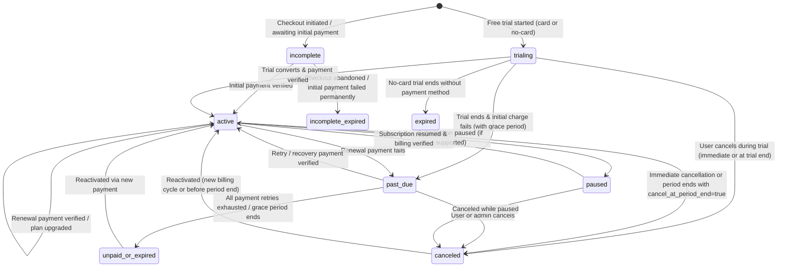

# Subscription Lifecycle & State Machine Guide

Use this reference during **Step 4 (Architecture Proposal)** and **Step 6 (Implementation Mode)** to design deterministic subscription states, transitions, and entitlement rules.

---

## 1. Canonical Subscription State Machine

While exact status names should adapt to the existing codebase or payment provider conventions, most subscription lifecycles map cleanly to these core states:

---

## 2. State Definitions & Entitlement Mapping

Do **not** equate `status == 'active'` with "has access" without considering trials, grace periods, and end-of-period cancellations. Define a single, canonical entitlement check function (e.g., `hasActiveEntitlement(subscription, now)`):

| Status | Business Meaning | Grants Paid Feature Access? | Key Timestamps to Check |
| :--- | :--- | :--- | :--- |
| `incomplete` / `pending` | Checkout session created, awaiting first confirmed payment. | **No** | `created_at` (expire stale records after e.g. 24h). |
| `trialing` | Customer is in an active free trial window. | **Yes**, while `now < trial_ends_at` | `trial_starts_at`, `trial_ends_at`, `cancel_at_period_end`. |
| `active` | Subscription is paid and in good standing for the current cycle. | **Yes**, while `now < current_period_end` (plus small clock/webhook buffer if applicable) | `current_period_start`, `current_period_end`, `cancel_at_period_end`. |
| `past_due` | Renewal date passed and payment failed; currently in retry/grace window. | **Configurable** (Yes if within `grace_period_ends_at`; No after grace period) | `current_period_end`, `grace_period_ends_at`. |
| `paused` | Billing and access temporarily suspended by user or admin policy. | **No** (or read-only access) | `paused_at`, `resumes_at`. |
| `canceled` | Subscription has been terminated. **Default convention**: When a user cancels mid-cycle with "cancel at period end", keep `status = 'active'` and set `cancel_at_period_end = true` until `current_period_end` passes, then transition `status` to `canceled` (or `expired`). Only if the existing codebase already sets `status = 'canceled'` immediately should you use that alternative, in which case `hasActiveEntitlement` must still grant access while `now < current_period_end` and `ended_at IS NULL`. | **Yes** only while `now < current_period_end` on end-of-period cancellations; **No** if revoked immediately (`ended_at <= now`) or after `current_period_end`. | `canceled_at`, `cancel_at_period_end`, `ended_at`, `current_period_end`. |
| `expired` / `unpaid` | Trial ended without conversion, or grace period/retries exhausted without payment. | **No** (fall back to free tier or read-only mode) | `ended_at`. |

> **Best Practice on Cancellation Representation**:
> Separating **auto-renewal intent** (`cancel_at_period_end: boolean` or `CanceledAt` timestamp) from **current cycle status** (`status: 'active'` until `current_period_end`, then transitioning to `canceled`/`expired` when the period actually ends) avoids bugs where users who cancel on day 5 of a 30-day cycle accidentally lose access 25 days early.

---

## 3. Lifecycle Operations & Edge Cases

### A. Free Trials
1. **Eligibility & Abuse Prevention**:
   - Track whether an owning entity (`user_id` or `organization_id`) has already consumed a trial (`has_used_trial` flag or historical subscription query) so users cannot repeatedly cancel and start new free trials.
   - For card-upfront trials, consider payment provider card fingerprint deduplication if trial abuse is a business concern.
2. **Trial-to-Paid Conversion**:
   - **With Card Upfront**: Provider automatically attempts to charge at `trial_ends_at`. On `invoice.paid`, transition `trialing -> active` and advance `current_period_end`. On `invoice.payment_failed`, transition to `past_due` or `expired`.
   - **Without Card Upfront**: Notify user before `trial_ends_at`. If user upgrades during trial, clarify whether the paid cycle starts immediately or appends after the remaining trial days. If `trial_ends_at` passes without payment, transition `trialing -> expired`.

---

### B. Upgrades, Downgrades, and Billing Interval Changes
Always clarify and document the exact behavior for plan changes:

| Change Type | Recommended Default Pattern | Financial & Access Mechanics |
| :--- | :--- | :--- |
| **Tier Upgrade** (e.g., Basic `$10/mo` -> Pro `$30/mo`) | **Immediate Effect + Proration** | Grant Pro entitlements immediately upon payment verification. Charge the prorated difference for the remaining days of the current cycle (or reset the billing cycle anchor to `now` if using a gateway without proration). |
| **Tier Downgrade** (e.g., Pro `$30/mo` -> Basic `$10/mo`) | **End-of-Period Scheduled Change** | Do **not** issue partial cash refunds or strip Pro features mid-cycle unless explicitly required. Record `scheduled_plan_id = 'basic'` (or schedule a phase in the provider). Keep Pro access until `current_period_end`, then renew on Basic at `$10/mo`. |
| **Interval Upgrade** (e.g., Monthly -> Annual) | **Immediate Effect** | Switch cycle to Annual immediately, crediting unused days of the current monthly period against the annual invoice. |
| **Interval Downgrade** (e.g., Annual -> Monthly) | **End-of-Period Scheduled Change** | Schedule switch to Monthly at the end of the current annual term (`current_period_end`). |

**Downgrade Over-Quota Check**:
When a user or organization downgrades (or when a scheduled downgrade takes effect at period end), define what happens if their current usage exceeds the lower plan's limits (e.g., 12 team members on a 5-seat plan, or 50 GB stored on a 10 GB plan):
- **Never silently delete user data** on downgrade or expiration.
- Either block creating *new* resources until usage drops below the cap (soft lock / read-only over-quota), or require the admin to reduce seats before scheduling the downgrade.

---

### C. Failed Payments, Dunning, and Grace Periods
Cards fail frequently due to insufficient funds, expired cards, or bank 3DS prompts:
1. **Transition to `past_due`**: When a renewal charge fails, record the failure reason and set `status = 'past_due'`.
2. **Grace Period Access**: If business rules include a grace period (e.g., 3 to 7 days), set `grace_period_ends_at = current_period_end + grace_days` and continue granting access while prompting the user in-app and via email to update their payment method.
3. **Recovery**: When the retry or updated payment method succeeds, clear `grace_period_ends_at`, set `status = 'active'`, and set `current_period_end` to the end of the current billing period.
4. **Hard Cutoff**: If all retries fail and `now > grace_period_ends_at`, transition to `expired` / `unpaid` and revoke paid entitlements.

---

### D. Cancellations, Reactivations, and Refunds
1. **End-of-Period Cancellation (`cancel_at_period_end = true`)**:
   - User stops auto-renewal. They keep access until `current_period_end`.
   - **Undo / Un-cancel**: While `now < current_period_end`, allow the user to click "Resume Subscription" (`cancel_at_period_end = false`) without charging them again.
2. **Immediate Cancellation / Revocation**:
   - Used for admin revocation, fraud, chargebacks, or explicit immediate refund policies. Sets `status = 'canceled'`, `ended_at = now`, and immediately revokes paid access.
3. **Refunds & Disputes (Chargebacks)**:
   - Listen for refund and dispute/chargeback webhook events (`charge.refunded`, `charge.dispute.created`).
   - Distinguish between a **partial goodwill refund** (subscription remains active) and a **full refund / chargeback** (subscription should be immediately revoked or flagged for review, based on business policy).

---

### E. Metered Quotas, Credit Ledgers & Sub-Cycle Resets

When a subscription or prepaid pack includes consumable limits (e.g., 50 template downloads/month, 120 render minutes/month, or 3 AI essay grading credits):

#### E.1 Choosing a Quota Reset Model

**Ask the developer to choose one of these three models** during Round 2 of the interview before proposing a schema. Do not assume the reset model from the billing interval alone.

| Model | Definition | When to Use |
| :--- | :--- | :--- |
| **Calendar-Month Reset** | Resets on the 1st of each calendar month UTC (or a configured timezone). | Simple UX ("you get 50 downloads per calendar month"); easy to explain; quotas align across all subscribers regardless of their signup date. |
| **Subscription-Anniversary Reset** | Resets on the monthly anniversary of `current_period_start` (e.g., signed up on the 15th → resets every 15th). | Billing-aligned: quota window matches the billing period exactly. Common when using Approach B Stripe Billing (aligns with invoice periods). |
| **Rolling 30-Day Window** | Resets relative to the oldest consumption in the window (or computed as `quota_period_start = now - 30 days`). | Most fair for high-frequency usage; hardest to implement and explain to users. Use only when explicitly required. |

> **Annual plan + monthly quota**: If a plan is billed annually (`billing_interval = 'year'`) but its usage quota resets monthly, **do not** scope the usage counter to `current_period_start..current_period_end` (which spans 12 months). Instead, track a `quota_period_start` / `quota_period_end` sub-cycle. For the subscription-anniversary model, derive sub-periods from `current_period_start + N months` (not from `current_period_end`, which is 12 months away).

#### E.2 Deduplicating Repeat Access vs. New Consumption

For asset/content libraries (e.g., downloading templates or courses), record unique `(owner_id, resource_id, quota_period_start)` grants so re-downloading an already-unlocked asset in the same period does not burn a second quota credit.

#### E.3 Two-Phase Quota Reservation for Long-Running / Failing Jobs

When an action consumes scarce credits or compute minutes (e.g., AI grading, 4K video rendering) that can fail mid-execution due to system errors:

1. **Reserve**: Inside a database transaction, verify `available >= cost` and create a `reserved` usage entry with a `reserved_until` timestamp (e.g., `now + max_expected_job_duration`). Do not start the job until the reservation is committed.
2. **Commit**: When the job succeeds, verify `entry.status = 'reserved'` inside a transaction before marking it `consumed`. If the entry is already `released` (cleaned up by the lease expiry job), log and discard the result — do **not** re-consume the balance.
3. **Release**: When the job fails due to an internal or provider error, verify `entry.status = 'reserved'` inside a transaction before restoring quota. If another error handler already released it, do nothing (idempotent double-release prevention).

#### E.4 Reservation Lease Expiry & Abandoned-Job Recovery

If a worker crashes after creating the reservation but before calling commit or release, the reservation will be stuck in `status = 'reserved'` with no completion.

A cleanup background job should:
1. Find reservation entries where `status = 'reserved'` and `reserved_until < now`.
2. Transition them to `status = 'released'` and restore the quota balance (atomic update inside a transaction).
3. Log the recovery so the developer is alerted to investigate the crashed worker.

After cleanup, any delayed worker that arrives with a commit callback must check `entry.status = 'reserved'` before consuming — since the status will be `'released'`, the commit is ignored.

---

### F. Marketplace Seller Offboarding & Price Grandfathering

In two-sided marketplaces where sellers/coaches/creators own plans:

1. **Price Grandfathering**: Never overwrite the billing amount of active subscribers when a seller edits a plan's price unless the subscriber explicitly consents. Store `unit_amount_minor` on the `subscriptions` row or create an immutable new `plan_price_id` version for new checkouts.

2. **Seller Deactivation / Ban — Policy-First Requirement**:

   **Before proposing any implementation**, ask the developer to explicitly choose one of the following policies during the developer interview (Round 2):

   | Policy | Behavior on Seller Deactivation |
   | :--- | :--- |
   | **A — Immediate Cancellation** | All active buyer subscriptions to that seller end immediately. Provider subscriptions are canceled immediately. Buyers may receive a prorated refund if business rules require it. |
   | **B — End-of-Period Expiry** | Existing paid periods run to their natural `current_period_end`. No new charges are made. Subscriptions expire naturally. Buyers retain access until their paid period ends. |
   | **C — Transition / Escrow** | Subscriptions continue but the platform takes over access management (e.g., assigning content to another seller, or placing the subscription in a managed wind-down state). Requires explicit content migration or handoff logic. |

   Until the developer confirms the offboarding policy, do not propose any specific cancellation or expiry implementation. Existing buyer entitlements must be protected according to the confirmed policy during the offboarding window.

3. **Implementation After Policy Confirmation**: Trigger a background workflow when a seller account is deactivated or banned that applies the chosen policy atomically for all active buyer subscriptions scoped to that seller (`buyer_id, seller_id`).
