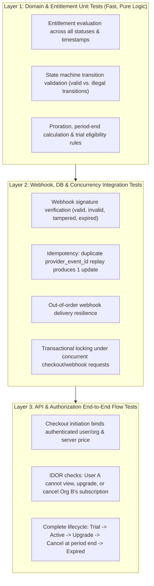

# Subscription Testing & Verification Strategy

Use this reference during **Step 4 (Architecture Proposal)** and **Step 7 (Testing & Verification)** to design and execute comprehensive tests for subscription functionality.

> **Truthfulness Rule**: Never claim tests were run or passed unless you actually executed the test runner in the workspace and verified the output. If an external live sandbox cannot be reached from the test environment, test via deterministic local mocks/fixtures and clearly document what was verified locally vs. what requires live staging verification.

---

## 1. Three-Layer Testing Pyramid for Subscriptions

Subscription bugs rarely happen on the initial happy-path checkout; they happen on day 30 when a renewal fails, when a webhook arrives twice, or when a user cancels mid-cycle. Cover all three layers:

---

## 2. Essential Test Cases Matrix

When implementing tests in **Step 7**, ensure the test suite covers these concrete scenarios using the project's existing test framework (e.g., Vitest, Jest, Pytest, RSpec, Go `testing`, JUnit, PHPUnit):

### A. Entitlement & Time-Boundary Tests
Use deterministic clock mocking or injectable `now` timestamps—never use `sleep()` to wait for billing cycles:
1. **Active within period**: `status = 'active'`, `now < current_period_end` $\rightarrow$ **Access Granted**.
2. **Active but period expired (missed webhook)**: `status = 'active'`, `now > current_period_end` (beyond any configured buffer) $\rightarrow$ **Access Denied** (or triggers lazy reconciliation).
3. **Trialing within window**: `status = 'trialing'`, `now < trial_ends_at` $\rightarrow$ **Access Granted**.
4. **Trial expired**: `status = 'trialing'`, `now >= trial_ends_at` $\rightarrow$ **Access Denied**.
5. **Canceled at period end (still in paid period)**: `status = 'active'` (or `'canceled'`), `cancel_at_period_end = true`, `now < current_period_end` $\rightarrow$ **Access Granted**.
6. **Canceled at period end (after period ends)**: `cancel_at_period_end = true`, `now >= current_period_end` $\rightarrow$ **Access Denied**.
7. **Immediate revocation / refund**: `status = 'canceled'`, `ended_at <= now` $\rightarrow$ **Access Denied immediately**.
8. **Past due within grace period**: `status = 'past_due'`, `now < grace_period_ends_at` $\rightarrow$ **Access Granted** (if grace period enabled).
9. **Past due after grace period**: `status = 'past_due'`, `now >= grace_period_ends_at` $\rightarrow$ **Access Denied**.

---

### B. Webhook Security, Idempotency & Crash-Recovery Tests
Construct signed webhook fixtures using a test signing secret to test the actual HTTP webhook route and worker recovery loop:
1. **Valid Signature & First Delivery**: Returns `2xx`, updates subscription state, and records `provider_event_id` as `processed` (`attempt_count = 1`) in `payment_webhook_events`.
2. **Invalid / Missing Signature**: Returns `400` or `401`, does **not** mutate database state or persist an event.
3. **Tampered Payload Body**: Valid signature header for original body, but body amount/status modified $\rightarrow$ rejected with `400`/`401`.
4. **Out-of-Order Events**:
   - Simulate `subscription.deleted` (timestamp $T_2$) arriving *before* `subscription.updated` (timestamp $T_1 < T_2$). Assert the final state remains `canceled` rather than reverting to `active`.
5. **Currency / Amount Mismatch (Business-Data Anomaly)**:
   - Send a valid signed webhook where `paid_amount` is less than the plan price or `currency` does not match. Assert the subscription is **not** activated and the event is recorded as `failed_permanent` with `last_error` diagnostics.
6. **Two Simultaneous Deliveries of the Same Event**:
   - Spawn two concurrent webhook deliveries with the exact same `provider_event_id`.
   - Assert: only one worker claims the lease and executes the subscription state transition; `current_period_end` advances **exactly once**; only 1 `payment_webhook_events` row exists (`status = 'processed'`).
7. **Successful Event Delivered Again After Processing**:
   - Deliver an event that has already completed (`status = 'processed'`).
   - Assert: returns `200 OK` immediately (`duplicate: true`), `attempt_count` does not increment, and business logic does not re-run.
8. **Crash Immediately After Event Claiming (Lease Expiry Recovery)**:
   - Simulate a worker claiming the event (`status = 'processing'`, `lease_owner = 'wrk_1'`, `lease_expires_at = now + 5m`) and crashing before applying the state transition.
   - Advance clock past `lease_expires_at` and run internal recovery.
   - Assert: a new worker reclaims the row (`attempt_count = 2`), applies the subscription state transition once, and marks `status = 'processed'`.
9. **Crash After Durable Enqueue Before Worker Completion**:
   - Durably accept a webhook (`status = 'pending'` with `payload_json` stored in `payment_webhook_events`), then simulate the initial worker crashing before claiming/completing it.
   - Assert: the event remains safely in `payment_webhook_events` (`status = 'pending'`) and is completed by the recovery worker.
10. **Internal Recovery Without Relying on Another Provider Delivery**:
    - Using the crashed state from Test 8 or Test 9 (where the payment provider already received `2xx` and sends **zero** additional HTTP requests), invoke `recoverStaleWebhookEvents(now)`.
    - Assert: the internal recovery loop reads `payload_json` from `payment_webhook_events`, executes the subscription transition, and transitions the event to `status = 'processed'` without any second webhook HTTP call.
11. **Expired Worker Attempting to Complete After a Newer Worker Reclaimed the Event (Lease Fencing)**:
    - Worker A claims the event (`lease_owner = 'wrk_A'`, `lease_expires_at = T_1`) and stalls.
    - At $T_2 > T_1$, Worker B reclaims the expired lease (`lease_owner = 'wrk_B'`) and completes the event (`status = 'processed'`).
    - Worker A wakes up and attempts to commit its state transition using `lease_owner = 'wrk_A'`.
    - Assert: Worker A's fenced update (`WHERE lease_owner = 'wrk_A' AND status = 'processing'`) matches `0` rows, aborts/rolls back (`409 Stale Lease`), and does **not** double-apply or overwrite Worker B's committed state.
12. **Transient Database Failure Followed by Successful Retry**:
    - Simulate a transient database error during webhook ingestion or worker execution.
    - Assert: if the failure occurs before durable persistence (or in Synchronous Option A), the transaction rolls back completely and returns `5xx` so the next retry claims and processes the event cleanly; if the failure occurs during async worker execution after durable persistence, the transaction rolls back, records `status = 'failed_transient'` and `last_error`, and the subsequent retry/recovery attempt succeeds and sets `status = 'processed'`, `last_error = NULL`.

---

### C.1 Quota Reservation Recovery Tests
13. **Worker Crash During Reservation**:
    - Create a quota reservation (`status = 'reserved'`, `reserved_until = now - 1 minute`).
    - Run the reservation lease cleanup job.
    - Assert: `status` transitions to `'released'` and the quota balance is restored.
    - Assert: a subsequent fresh reservation for the same resource succeeds using the restored balance.
14. **Delayed Worker After Lease Release**:
    - Create a reservation, run the cleanup job (auto-releasing it), then send a late commit callback for the already-released reservation.
    - Assert: the commit is ignored (`entry.status` is already `'released'`; balance is **not** decremented again).
    - Assert: the quota balance matches the original pre-reservation value.
15. **Duplicate Completion Callback**:
    - Create a reservation and send a successful commit callback twice (simulating double-delivery of the job completion event).
    - Assert: `status` transitions to `'consumed'` exactly once; the quota balance is decremented exactly once (not twice).

---

### C. Authorization & Multi-Tenancy Security Tests
1. **Unauthenticated Access**: Calling checkout, portal, or cancel endpoints without authentication returns `401`.
2. **Cross-User / Cross-Tenant IDOR**: Authenticate as `User A` (or `Org A`) and attempt to view billing history, upgrade, or cancel `User B` / `Org B`'s subscription ID. Assert `403 Forbidden` or `404 Not Found`.
3. **Role-Based Billing Permission (B2B)**: Authenticate as a standard `member` (non-admin) of `Org A` and attempt to upgrade or cancel `Org A`'s subscription. Assert `403 Forbidden` if billing is restricted to `owner` / `billing_admin`.
4. **Price Tampering Resistance**: Send extra body fields (`price: 0`, `amount: 1`, `status: 'active'`, `trial_days: 9999`) to the checkout initiation endpoint. Assert they are ignored or rejected, and the server uses the canonical plan configuration.
5. **Repeat Trial Prevention**: After a user/organization completes or cancels a trial, attempt to start a second free trial for the same entity. Assert the backend rejects the second trial or initiates a paid checkout instead.

---

## 3. Staging & Provider Sandbox Verification Guide

In addition to automated tests in the repository, provide the developer with a clear manual/staging verification runbook when applicable:
- **Webhook Tunneling (Local Dev)**: Instructions for testing live provider sandbox webhooks locally (e.g., `stripe listen --forward-to localhost:PORT/webhooks/...` or temporary webhook tunnel) using test API keys.
- **Test Cards & Clock Simulation**: Recommend using provider test clocks (e.g., Stripe Test Clocks) or short sandbox intervals to verify multi-month renewals and failed-card dunning retries before going live.
- **Environment Variable Verification**: Checklist of required environment variables (`PAYMENT_SECRET_KEY`, `PAYMENT_WEBHOOK_SECRET`, `APP_BASE_URL`, price IDs) needed for staging and production.
