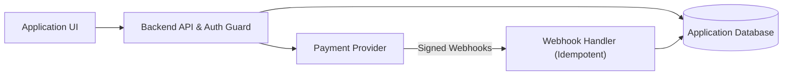

# Subscription Architecture Proposal: [Project Name]

> **Status**: Draft — Awaiting Developer Approval  
> **Operating Mode**: Architecture Mode (No application code has been modified)  
> **Date**: [YYYY-MM-DD]

---

## Executive Summary (Plain-Language Overview)

*Provide a concise, non-jargon summary (3–5 sentences) of what is being built, who pays whom, how access is granted and revoked, and which architectural approach is recommended so both engineers and business stakeholders can validate the core model.*

---

## 1. Requirements Discovered

### 1.1 Existing Repository Facts (From Codebase Inspection)
- **Language & Framework**: [e.g., TypeScript, Next.js App Router / Python FastAPI / Go]
- **Database & ORM**: [e.g., PostgreSQL with Prisma / MySQL with Drizzle / MongoDB]
- **Authentication & Tenancy Model**: [e.g., Session-based User auth; Organizations table with `owner` and `member` roles]
- **Existing Payment / Billing Code**: [e.g., Stripe SDK v14 installed for one-time orders; no recurring billing or webhook idempotency table yet]
- **Test & Deployment Setup**: [e.g., Vitest + Supertest; Dockerized deployment]

### 1.2 Confirmed Business Requirements (From Developer Interview)
- **What is Subscribed To**: [e.g., Workspace access to Pro analytics and increased project quotas]
- **Subscription Owner Entity**: [e.g., `Organization` (`organization_id`) / Individual `User` (`user_id`)]
- **Plan Creators**: [e.g., Fixed platform tiers / Admin-configurable / Marketplace sellers]
- **Tiers, Pricing & Billing Intervals**: [e.g., Free ($0), Pro ($20/mo or $200/yr), Enterprise (custom)]
- **Trials, Discounts & Add-ons**: [e.g., 14-day free trial without card upfront; 1 trial per organization]
- **Payment Provider & Capabilities**: [e.g., Stripe Billing (supports native recurring subscriptions and signed webhooks) / Regional gateway (one-time redirect checkout only)]
- **Cancellation, Failed Payments & Expiration Rules**: [e.g., Cancel at period end; 3-day grace period on failed renewals; read-only access to existing data upon expiration]

---

## 2. Remaining Assumptions & Open Questions

*List any assumptions made where requirements were not explicitly specified, and highlight any remaining questions the developer should confirm before implementation.*

- **Assumptions**:
  1. [Assumption 1 — e.g., Existing registered users without a subscription default to the `Free` tier entitlements.]
  2. [Assumption 2 — e.g., Upgrades take effect immediately with proration; downgrades take effect at the end of the current billing period.]
- **Open Questions (if any)**:
  1. [Question 1 — or "None; all critical requirements confirmed."]

---

## 3. Recommended Architecture

**Selected Approach**: **[Approach A: Application-Owned / Approach B: Payment-Provider-Managed / Approach C: Existing Shared Service / Approach D: Hybrid / Non-Subscription Pattern]**

### High-Level Architecture Overview
*Describe how the components interact (Application Frontend, Application Backend, Database, Payment Provider / Shared Service, and Background Workers if any).*

### Division of Responsibilities
| Responsibility | System of Record / Owner | How It Works |
| :--- | :--- | :--- |
| **Plan & Price Definitions** | [e.g., App Config + Payment Provider] | [Explanation] |
| **Recurring Charge Scheduling** | [e.g., Payment Provider / App Cron Worker] | [Explanation] |
| **Subscription State & Dates** | [e.g., App `subscriptions` table synced via webhooks] | [Explanation] |
| **Feature Entitlement Checks** | [e.g., App Backend Middleware (`requireEntitlement`)] | [Explanation] |
| **Invoicing & Retry Dunning** | [e.g., Payment Provider / App Notification Job] | [Explanation] |

---

## 4. Why This Architecture Was Selected

*Explain the concrete evidence from the codebase and business model that makes this approach the right fit:*

1. **Alignment with Payment Provider Capabilities**: [Why this matches the gateway's native recurring/non-recurring capabilities]
2. **Fit for Domain & Tenancy Model**: [Why this fits the user/org/marketplace ownership structure]
3. **Right-Sized Operational Complexity**: [How this avoids unnecessary microservices, extra infrastructure, or premature abstractions]
4. **Compatibility with Existing Codebase**: [How this builds cleanly on existing auth, ORM, and project conventions]

---

## 5. Alternatives Considered & Why They Were Rejected

| Alternative Approach | Evaluation for This Project | Reason for Rejection |
| :--- | :--- | :--- |
| **Approach A: Application-Owned Implementation** | [Evaluated / Selected] | [If rejected: e.g., Rebuilding a custom recurring scheduler and retry engine is unnecessary when the chosen gateway natively handles recurring billing and proration.] |
| **Approach B: Payment-Provider-Managed Subscriptions** | [Evaluated / Selected] | [If rejected: e.g., The payment gateway does not support native recurring subscriptions or dynamic seller-defined plans.] |
| **Approach C: Existing Shared Subscription Service** | [Evaluated / Selected] | [If rejected: e.g., No shared subscription service exists in the organization, and introducing a standalone billing microservice for a single application adds unnecessary network and operational complexity.] |
| **Approach D: Hybrid Implementation** | [Evaluated / Selected] | [If rejected: e.g., The pricing and entitlement rules do not require splitting billing and local metered ledgers.] |
| **Non-Subscription Model (One-Time / Credits)** | [Evaluated / Selected] | [If rejected: e.g., The business model requires recurring monthly/annual access renewals rather than permanent one-time unlocks.] |

---

## 6. Database Changes & Entity Relationships

### 6.1 Proposed Schema Additions / Modifications
*Select the schema tier from `references/database-design.md` that fits the recommended pattern (or define only `orders` / `credit_ledger_entries` + `payment_webhook_events` if recommending a Non-Subscription pattern). Detail the exact tables, columns, types, constraints, and indexes to add or modify:*

- **Table 1: `subscriptions`** *(or `orders` / `user_entitlements` if Non-Subscription Pattern)*
  - `id` (PK)
  - `owner_type` / `owner_id` (FK to `users.id` or `organizations.id`, indexed; or `(buyer_id, seller_id)` for marketplaces)
  - `plan_id` (identifies active tier)
  - `scheduled_plan_id` (nullable, for end-of-period downgrades)
  - `status` (`incomplete`, `trialing`, `active`, `past_due`, `paused`, `canceled`, `expired`)
  - `current_period_start`, `current_period_end`, `trial_ends_at`, `grace_period_ends_at`
  - `cancel_at_period_end` (boolean), `canceled_at`, `ended_at`
  - `payment_provider`, `provider_customer_id`, `provider_subscription_id` (unique)
  - `created_at`, `updated_at`
- **Table 2: `payment_webhook_events`** (Durable Inbox & Idempotency Log)
  - `id` (PK), `provider`, `provider_event_id` (`UNIQUE (provider, provider_event_id)`), `event_type`, `payload_json`, `status` (`pending`, `processing`, `processed`, `failed_transient`, `failed_permanent`), `attempt_count`, `lease_owner`, `lease_expires_at`, `last_error`, `processed_at`, `created_at` *(or minimal single-transaction columns if using Synchronous Option A)*
- **[Additional Tables if Required]**: *(e.g., `plans`, `subscription_payments`, `usage_records` — include only what is needed)*

### 6.2 Integrity Constraints & Indexes
- **Duplicate Active Subscription Prevention**: [e.g., Partial unique index on `(owner_id) WHERE status IN ('trialing', 'active', 'past_due')`, scoped to `(buyer_id, seller_id)` for marketplaces, or row-level locking strategy]
- **Monetary Representation**: [e.g., Minor units (`amount_minor` integer) + ISO 4217 `currency`]
- **Key Indexes**: [e.g., `(owner_id, status)`, `(provider, provider_subscription_id)`, `(status, current_period_end)`]

---

## 7. Subscription Lifecycle & State Machine

### 7.1 State Transitions
*(Adapt if recommending a Non-Subscription one-time purchase or prepaid credit ledger model.)*
| State | How It Enters This State | Grants Paid Access? | Next Possible States |
| :--- | :--- | :--- | :--- |
| `incomplete` | User initiates checkout; awaiting payment confirmation. | No | `active`, `expired` |
| `trialing` | User starts a free trial. | Yes (while `now < trial_ends_at`) | `active`, `past_due`, `canceled`, `expired` |
| `active` | Initial or renewal payment verified on server. | Yes (while `now < current_period_end`; if `cancel_at_period_end = true`, remains `active` until `current_period_end`) | `active`, `past_due`, `canceled`, `expired` |
| `past_due` | Renewal charge fails; enters grace/retry window. | [Yes during $N$-day grace / No] | `active`, `expired`, `canceled` |
| `canceled` | Subscription terminated immediately (`ended_at <= now`) or period ended with `cancel_at_period_end = true`. | No (unless existing codebase uses `status = 'canceled'` before `current_period_end`) | `active` (via reactivation) |
| `expired` | Trial, grace period, or billing period ends without renewal. | No (reverts to Free/Read-Only) | `active` (via new checkout) |

### 7.2 Business Rules for Plan Changes
- **Upgrades**: [e.g., Immediate transition upon payment/proration confirmation.]
- **Downgrades**: [e.g., Scheduled for `current_period_end`; existing data preserved without deletion if over quota.]
- **Cancellations & Reactivations**: [e.g., Sets `cancel_at_period_end = true`; user can un-cancel before `current_period_end` or re-subscribe after expiration.]

---

## 8. Payment & Webhook Verification Flow

1. **Checkout Initiation**:
   - Client sends `plan_id` (never raw prices) to `POST /api/...`.
   - Server authenticates the user, verifies ownership/permissions, resolves the authoritative price on the server, and binds `(owner_id, plan_id, internal_ref)` into the provider session metadata.
2. **Client Return / Redirect Handling**:
   - The frontend return URL (`/billing/return`) **never** activates the subscription directly. It polls subscription status or triggers a server-to-server verification call.
3. **Server-Side Webhook Processing**:
   - Raw request body cryptographic signature verification (`HMAC` / SDK verifier) before parsing or processing.
   - Consistent processing model (`references/payment-integration.md` §3.1):
     - **Durable Asynchronous Processing (Primary Model)**: Atomically persist the verified event (`payload_json`, `status = 'pending'`) on `UNIQUE (provider, provider_event_id)` before acknowledging the provider (`202`/`200`). Workers claim events with a fencing token (`lease_owner`, `lease_expires_at`, `attempt_count`) and commit the subscription state transition + `status = 'processed'` in one transaction **only if `lease_owner` still matches**. Internal recovery reclaims expired leases without relying on provider retries.
     - **Synchronous Single-Transaction Alternative (Option A)**: Insert the event (`status = 'processed'`) and apply the subscription state transition inside **one** atomic transaction so any failure rolls back the event claim completely and allows a provider retry to succeed.
   - Out-of-order protection ensuring older events cannot overwrite newer terminal states.

---

## 9. API & Service Contract Changes

| Endpoint / Method | Auth & Permission Required | Purpose | Request / Response Summary |
| :--- | :--- | :--- | :--- |
| `GET /api/subscriptions/current` | Authenticated User / Org Member | Fetch current subscription status, plan limits, and renewal date. | Returns `{ status, plan, currentPeriodEnd, cancelAtPeriodEnd }` |
| `POST /api/subscriptions/checkout` | Authenticated Owner / Billing Admin | Initiate checkout session for a target `plan_id`. | Req: `{ planId, interval }` $\rightarrow$ Res: `{ checkoutUrl }` |
| `POST /api/subscriptions/change-plan` | Authenticated Owner / Billing Admin | Upgrade or schedule downgrade to another `plan_id`. | Req: `{ targetPlanId }` $\rightarrow$ Res: `{ updatedSubscription }` |
| `POST /api/subscriptions/cancel` | Authenticated Owner / Billing Admin | Cancel subscription at period end (or resume if pending cancel). | Req: `{ cancelAtPeriodEnd: true }` $\rightarrow$ Res: `{ status }` |
| `POST /api/webhooks/[provider]` | Raw Body + Provider Signature Header | Receive and process asynchronous payment & lifecycle events. | Req: Raw Provider Payload $\rightarrow$ Res: `200 OK` |

---

## 10. Authentication, Authorization & Security Controls

- **Subscription Ownership Binding**: Every subscription is strictly bound to `[user_id / organization_id]`.
- **IDOR Prevention**: Every read and mutation endpoint verifies that the authenticated actor owns (or has `billing_admin` permission for) the target subscription.
- **Entitlement Enforcement Point**: Centralized server-side guard (`[e.g., requireSubscriptionEntitlement()]`) applied to protected API routes/actions.
- **Secrets Management**: Required environment variables (`[e.g., STRIPE_SECRET_KEY, STRIPE_WEBHOOK_SECRET]`) kept strictly server-side.

---

## 11. Failure Handling, Edge Cases & Recovery

- **Duplicate Webhook Delivery**: Safely ignored via `payment_webhook_events` unique constraint; returns `200 OK`.
- **Delayed or Out-of-Order Webhooks**: Handled via timestamp/state comparison and server-to-server status verification on the return page.
- **Failed Renewal Payments**: Transitions to `past_due`, notifies the customer, and maintains access until `grace_period_ends_at`.
- **Missed Webhooks / Drift Recovery**: [e.g., On-demand status sync endpoint / daily reconciliation check for active subscriptions with `current_period_end < now`].
- **Outbound Network Failures**: Deterministic idempotency keys passed on all outbound payment API calls to prevent double charges.

---

## 12. Migration & Backward-Compatibility Strategy

- **Existing Users / Data Impact**: [e.g., No destructive changes to existing tables; existing users default to Free tier / backfilled via non-destructive migration script.]
- **Rollout Plan**: [e.g., Expand-Contract schema migration $\rightarrow$ deploy webhook handler $\rightarrow$ enable checkout UI.]

---

## 13. Testing Strategy

- **Unit Tests**: Entitlement evaluation across all statuses (`trialing`, `active`, `past_due`, `canceled`, `expired`) and time boundaries (`now` vs. `current_period_end` / `grace_period_ends_at`).
- **Integration Tests**: Webhook signature validation (valid, invalid, tampered), duplicate `provider_event_id` idempotency replay, and out-of-order event delivery.
- **Authorization & API Tests**: Price tampering rejection, cross-user/cross-tenant IDOR prevention, and repeat trial prevention.

---

## 14. Risks & Trade-Offs

| Risk / Trade-Off | Impact | Mitigation |
| :--- | :--- | :--- |
| [e.g., Webhook delivery delay after checkout redirect] | User lands on dashboard 2 seconds before webhook arrives. | Return endpoint performs a direct server-to-server session verification if local state is still `incomplete`. |
| [e.g., Clock skew or missed expiration webhook] | User retains access slightly past `current_period_end`. | Entitlement guard checks `now < current_period_end` directly in addition to `status`. |

---

## 15. Proposed Implementation Phases

1. **Phase 1 — Database Schema & Models**: Create migrations and model definitions for `subscriptions` and `payment_webhook_events` (plus `plans` if applicable).
2. **Phase 2 — Core Domain & Entitlement Guard**: Implement state machine helpers, canonical entitlement check (`hasActiveEntitlement`), and unit tests.
3. **Phase 3 — Payment & Webhook Integration**: Implement checkout session creation, server-side status verification, and idempotent webhook processing with integration tests.
4. **Phase 4 — API Endpoints & UI Integration**: Expose subscription management endpoints, wire up frontend billing views, and run end-to-end authorization tests.
5. **Phase 5 — Documentation & Readiness Review**: Generate project billing docs and complete the production readiness checklist.

---

## Approval Request

Please review this architecture proposal:
1. Do the **subscription lifecycle rules** (trials, upgrades/downgrades, cancellations, grace periods) match your business expectations?
2. Do you approve proceeding to **Implementation Mode** with this design, or would you like to adjust any section first?
